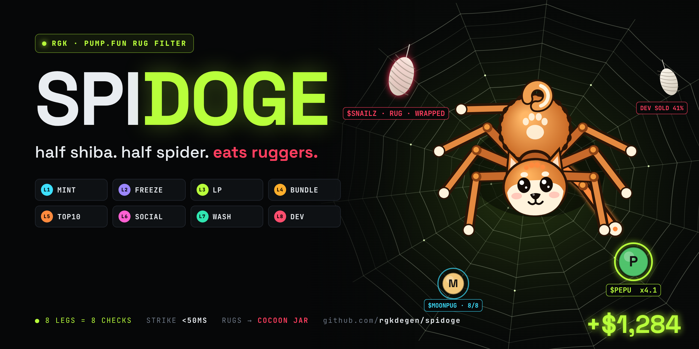

<p align="center">
  
</p>

<h1 align="center">SPIDOGE</h1>

<p align="center">
  <b>half shiba. half spider. eats ruggers.</b><br>
  An 8-legged pump.fun rug filter. It sits in the middle of a web, and every new mint lands on a thread.
</p>

<p align="center">
  
  
  
  
  
</p>

---

## The idea

Checking a fresh pump.fun token by hand means one tab for holders, one for the dev wallet and one for bundles. By the time you finish, the dev has already sold.

A spider doesn't check one thing at a time. It has 8 legs.

<p align="center">
  
</p>

▶ Full demo: [`assets/demo.mp4`](assets/demo.mp4) · Live terminal: [`terminal/index.html`](terminal/index.html)

---

## How the web works

```
 new mint ──► THE WEB ──► CRAWL ──► 8 LEGS ──┬──► any leg fails ──► WRAP  ──► cocoon jar
 (deploy)     thread      <50ms     8 checks │
              shakes                         └──► 8/8 clean ───────► BITE  ──► hold ──► DRAIN ──► bag
```

| Step | What happens |
|---|---|
| **THE WEB** | Every fresh pump.fun mint lands on a thread as soon as it's deployed, and the web vibrates. |
| **CRAWL** | Spidoge feels the vibration and runs to the coin. |
| **8 LEGS** | Each leg runs one check, in order. The first failure stops the scan. |
| **WRAP** | If a leg fails, the coin is wrapped in silk and dropped in the cocoon jar. No entry. |
| **BITE** | If all 8 legs pass, it bites. Default entry is 0.8 SOL. |
| **DRAIN** | At the target multiple, the profit runs back down the thread into the bag. |

## The 8 legs

| Leg | Check | Wraps the coin when… |
|---|---|---|
| `L1` **MINT** | mint authority | mint authority is still live |
| `L2` **FREEZE** | freeze authority | freeze authority is on |
| `L3` **LP** | curve liquidity | liquidity is pulled or unlocked |
| `L4` **BUNDLE** | block-0 snipers | more than 15% of supply was bundled at launch |
| `L5` **TOP10** | holder spread | top 10 wallets hold more than 35% |
| `L6` **SOCIAL** | X / Telegram signal | there are zero real accounts talking about it |
| `L7` **WASH** | volume quality | more than 40% of volume is wash |
| `L8` **DEV** | dev wallet | the dev sold more than 10%, or has shipped rugs before |

Thresholds live in [`src/config.ts`](src/config.ts).

## The one that sold me

```
$SNAILZ   L1 MINT    ✓ revoked
          L2 FREEZE  ✓ revoked
          L3 LP      ✓ curve-locked
          L4 BUNDLE  ✓ 3.4% bundled
          L5 TOP10   ✓ top10 24%
          L6 SOCIAL  ✓ 412 mentions
          L7 WASH    ✓ 86% organic
          L8 DEV     ✗ DEV SOLD 41% — 0.4s before entry

          → RUG · WRAPPED
```

## Demo session

| | |
|---|---|
| mints hitting the web | ~214 / min |
| rugs wrapped | 5 |
| not lost (dodged) | $1.9K |
| win rate | 61.4% |
| bag | $9,840 → $13,573 |

> Numbers in the demo video and terminal come from a scripted replay used for the visual. They are not a live trading record.

## Repo layout

```
spidoge/
├── terminal/index.html   # the SPIDOGE DESK terminal (self-contained, open in a browser)
├── src/
│   ├── config.ts         # leg thresholds, entry size, exit multiple
│   ├── legs.ts           # the 8 checks
│   ├── web.ts            # the web: mint intake → crawl → scan → wrap / bite
│   └── index.ts          # entry point
└── assets/               # banner, preview gif, demo video
```

## Run it

**Terminal (visual):** open `terminal/index.html` in any browser. It runs on its own and loops.

**Pipeline skeleton:**

```bash
npm install
cp .env.example .env    # set RPC_URL
npm run dev             # dry-run: logs WRAP / BITE decisions, sends no transactions
```

The `src/` pipeline is a reference skeleton. Each leg is a typed check you wire to your own data source (RPC, indexer, pump.fun API). It runs in dry-run mode by default.

## Disclaimer

This is not financial advice. Memecoins are mostly rugs, and that's the point of the spider. No filter catches everything. Never trade with money you can't lose.

---

<p align="center"><sub>one man's rug is a spider's lunch · built by <b>RGK</b></sub></p>
